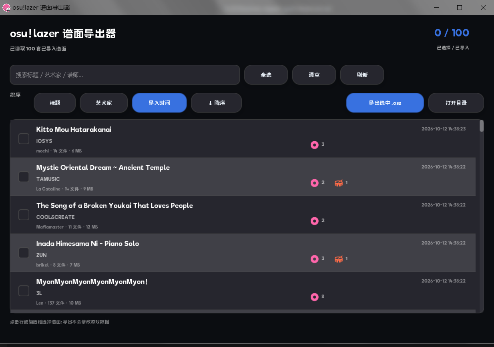

# osu!lazer 谱面导出器

一个本地小工具：读取 osu!lazer 的数据库，列出所有已导入谱面，勾选后重新打包为 `.osz`。



## 功能

- 列出全部已导入谱面，按标题 / 艺术家 / 导入时间排序，可切换升序、降序
- 每行显示：标题、艺术家、谱师、文件数、大小、导入时间
- 谱面类型徽章：std / taiko / catch / mania 图标 + 对应难度数量
- 搜索过滤（标题 / 艺术家 / 谱师）
- 导出选中谱面为标准 `.osz`（保留原始内部文件名、音频、背景、音效）

## 运行

需要 **.NET 8 运行时**。

双击运行`osz_export_gui.exe`

导出目录：`%USERPROFILE%\Documents\osu-lazer-osz-export`


## 构建

### Windows

依赖 CMake 3.14+、MinGW-w64 g++ 12+ / MSVC

```powershell
cmake -S . -B build -G "MinGW Makefiles" -DCMAKE_BUILD_TYPE=Release `
  -DCMAKE_C_COMPILER="gcc" `
  -DCMAKE_CXX_COMPILER="g++"
cmake --build build --parallel
```

EUI-NEO 路径 `-DEUI_NEO_SOURCE=<path>`  辅助程序目录 `-DOSZ_HELPER_DIR=<path>`

### Linux

```bash
sudo apt update
sudo apt install -y build-essential cmake ninja-build pkg-config \
  libgl1-mesa-dev libegl1-mesa-dev libx11-dev libxext-dev libxrandr-dev \
  libxinerama-dev libxcursor-dev libxi-dev libwayland-dev wayland-protocols \
  libxkbcommon-dev libglib2.0-dev libcurl4-openssl-dev libasound2-dev libpulse-dev

cmake -S . -B build -G Ninja -DCMAKE_BUILD_TYPE=Release \
  -DEUI_NEO_SOURCE=/path/to/EUI-NEO
cmake --build build -j"$(nproc)"
# ./build/osz_export_gui
```

#### Linux 下的辅助程序

```bash
# lazer AppImage 可执行 --appimage-extract 得到 squashfs-root；deb/安装版通常在 /opt/osu-lazer
LAZER_DIR=/path/to/lazer            # 含 osu!.dll / Realm.dll 的目录
cp "$LAZER_DIR/Realm.dll" helper/
cp "$LAZER_DIR/MongoDB.Bson.dll" helper/
cp "$LAZER_DIR/librealm-wrappers.so" helper/   # 文件名可用 find 确认
```

- 保持 `Realm.dll` 与 `librealm-wrappers.so` 来自**同一份** lazer 安装；
- 需要 .NET 8 运行时。

数据目录：`$XDG_DATA_HOME/osu`，默认 `~/.local/share/osu`（Flatpak 为 `~/.var/app/sh.ppy.osu/data/osu`）。导出目录：`~/osu-lazer-osz-export`。

## 许可

源码采用 [MIT License](LICENSE)。

`assets/source/lazer-256.png`、`assets/icon*.png`、`assets/icon.ico` 及截图中出现的
osu! 图标为 osu!lazer 图标衍生资源，不适用 MIT；osu! 名称与图标归 ppy Pty Ltd 所有。
详见 [ATTRIBUTION.md](ATTRIBUTION.md)。

