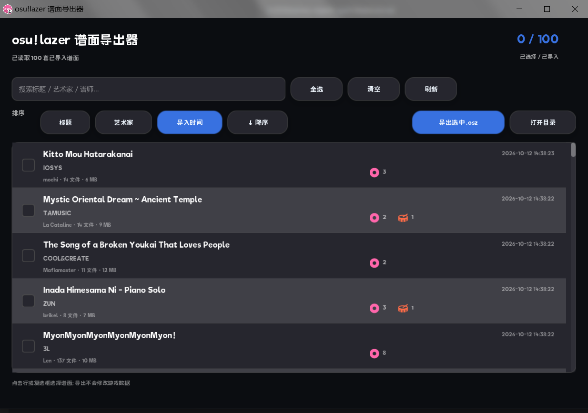

English | [简体中文](README.md)

# osu!lazer Beatmap Exporter

A small local tool that reads the osu!lazer database, lists all imported beatmaps, and
repacks the selected ones into `.osz` files.



## Features

- Lists every imported beatmap; sort by title / artist / import time, ascending or descending
- Each row shows the title, artist, mapper, file count, size, and import time
- Mode badges: std / taiko / catch / mania icons with the difficulty count for each mode
- Search filter (title / artist / mapper)
- Exports the selected beatmaps as standard `.osz` files (keeping the original internal
  filenames, audio, background, and hitsounds)

## Running

Requires the **.NET 8 runtime**.

Double-click `osz_export_gui.exe`.

Export directory: `%USERPROFILE%\Documents\osu-lazer-osz-export`

## Building

### Windows

Requires CMake 3.14+ and MinGW-w64 g++ 12+ / MSVC.

```powershell
cmake -S . -B build -G "MinGW Makefiles" -DCMAKE_BUILD_TYPE=Release `
  -DCMAKE_C_COMPILER="gcc" `
  -DCMAKE_CXX_COMPILER="g++"
cmake --build build --parallel
```

EUI-NEO path: `-DEUI_NEO_SOURCE=<path>`; helper directory: `-DOSZ_HELPER_DIR=<path>`

### Linux

```bash
sudo apt update
sudo apt install -y build-essential cmake ninja-build pkg-config \
  libgl1-mesa-dev libegl1-mesa-dev libx11-dev libxext-dev libxrandr-dev \
  libxinerama-dev libxcursor-dev libxi-dev libwayland-dev wayland-protocols \
  libxkbcommon-dev libglib2.0-dev libcurl4-openssl-dev libasound2-dev libpulse-dev

cmake -S . -B build -G Ninja -DCMAKE_BUILD_TYPE=Release \
  -DEUI_NEO_SOURCE=/path/to/EUI-NEO
cmake --build build -j"$(nproc)"
# ./build/osz_export_gui
```

#### Helper on Linux

```bash
# The lazer AppImage can be unpacked with --appimage-extract (squashfs-root);
# deb/installed builds usually live in /opt/osu-lazer
LAZER_DIR=/path/to/lazer            # directory containing osu!.dll / Realm.dll
cp "$LAZER_DIR/Realm.dll" helper/
cp "$LAZER_DIR/MongoDB.Bson.dll" helper/
cp "$LAZER_DIR/librealm-wrappers.so" helper/   # confirm the filename with find
```

- Keep `Realm.dll` and `librealm-wrappers.so` from the **same** lazer installation;
- Requires the .NET 8 runtime.

Data directory: `$XDG_DATA_HOME/osu`, defaulting to `~/.local/share/osu`
(Flatpak: `~/.var/app/sh.ppy.osu/data/osu`). Export directory: `~/osu-lazer-osz-export`.

## License

The source code is licensed under the [MIT License](LICENSE).

`assets/source/lazer-256.png`, `assets/icon*.png`, `assets/icon.ico`, and the osu! icon
shown in the screenshot are derived from the osu!lazer icon and are not covered by MIT;
the osu! name and logo belong to ppy Pty Ltd. See [ATTRIBUTION.md](ATTRIBUTION.md).
